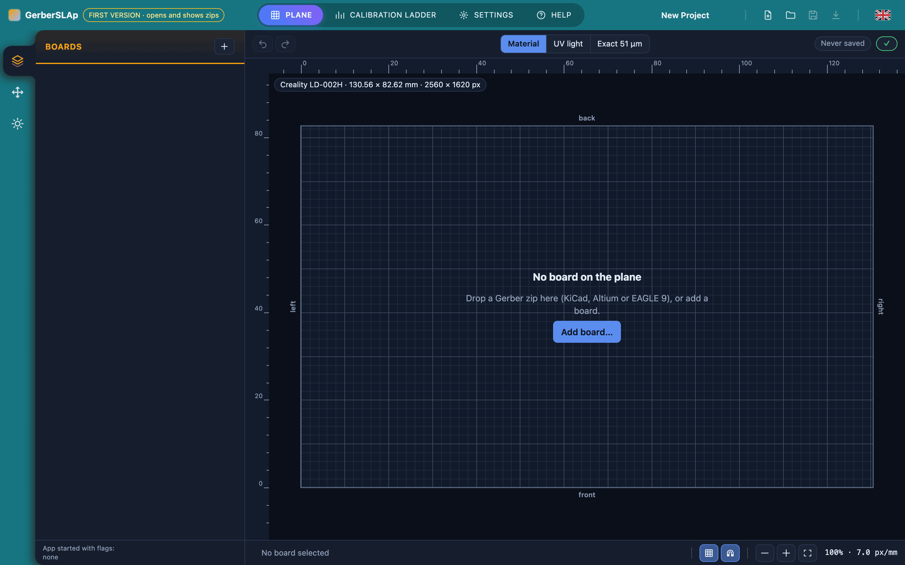
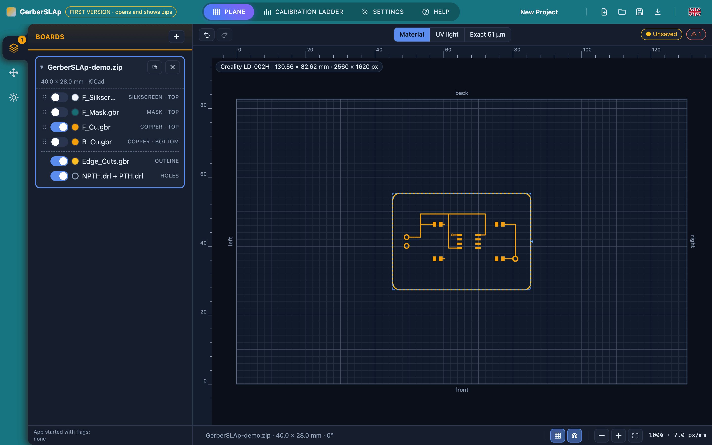
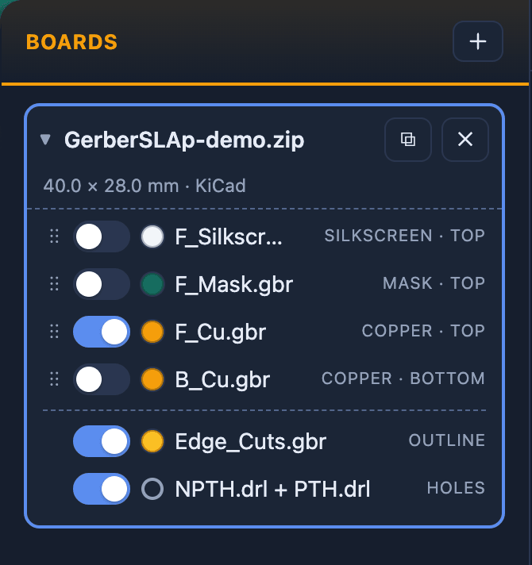
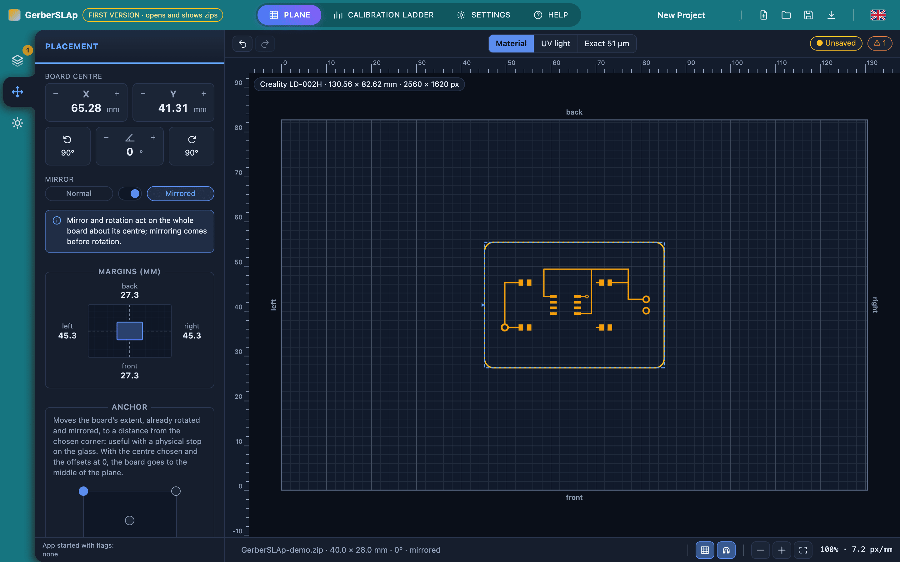
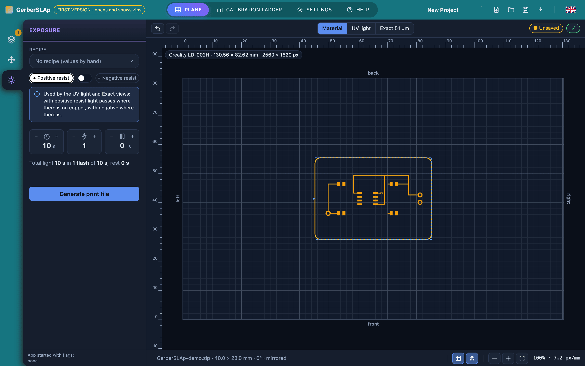
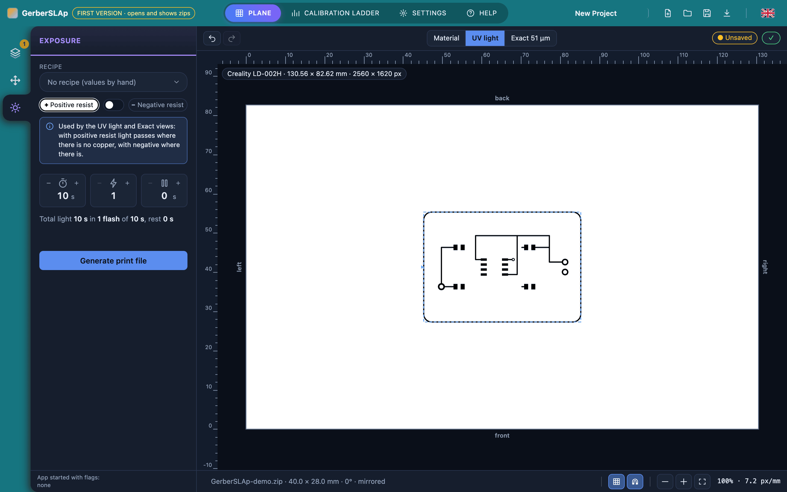
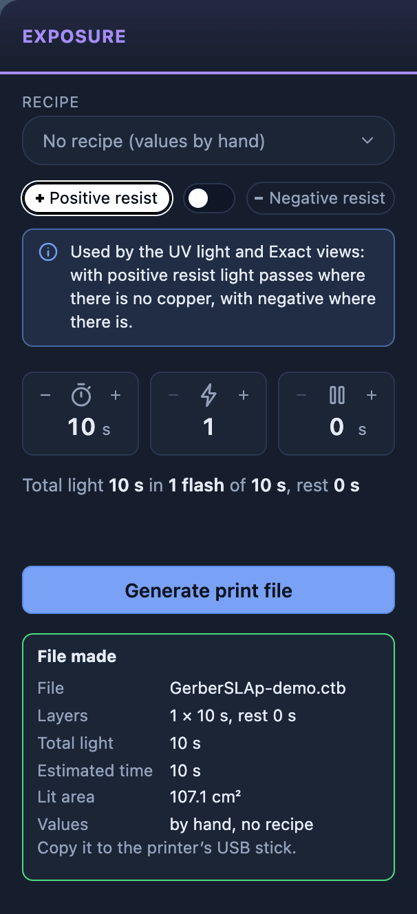

# First steps

This chapter takes you through preparing the first print file, from the Gerber zip to the exposure. It uses an **example board**, which you download from the site, so every step can be repeated with the same result. The following chapters explain each phase in detail. The images enlarge with a click.

!!! info "Before you start"
    The app must be running and the printer must show as **Ready**, that is with the template installed: see [Installing the app](../installation/install.md) and [Requirements and template](../installation/requirements.md#the-printer-template). Without a template everything works up to the generation, but the file cannot be produced.

## The example board

[Download GerberSLAp-demo.zip](../../assets/GerberSLAp-demo.zip){ .md-button }

It is an invented board of 40 × 28 mm: a small LED blinker with a SOIC-8 integrated circuit, three 0805 parts, a two-pin header and a test point. The zip holds the files a CAD program exports: copper on top and bottom, outline, solder mask, silkscreen and drills.

!!! warning "It only serves to learn the program"
    The design is made up for this manual: it is not a verified project and it was never etched.

## 1. Add the board

Open the app in the browser (usually `http://127.0.0.1:8800`). In the middle is the **plane**, that is the LCD screen seen from above with Rulers in millimetres, and at the top left the **PrinterPill** says which printer is in use: here the Creality LD-002H, 130.56 × 82.62 mm.

[{ loading=lazy }](img/first-steps-1-empty.png){ target=_blank }

Drag the zip onto the page, or press “Add board…”. The board appears on the plane and in the **Boards** section.

[{ loading=lazy }](img/first-steps-2-board.png){ target=_blank }

## 2. What you see

The **BoardCard** in the Boards section gives the file name, the size (40.0 × 28.0 mm) and the CAD program the app recognised by itself: here KiCad, because the file names follow the ones KiCad writes. Below are the **layers** of the zip, each with its role (silkscreen, mask, top copper, bottom copper, outline, holes).

{ width="335" loading=lazy }

Each layer has a switch: **the print file exposes the layers that are on**. When the board is opened the top copper, the outline and the holes are on, and that is exactly what the plane shows. For the example they stay as they are; with a real board you switch on the copper layer to expose.

## 3. Place it

The **Placement** section (the second icon of the **SideBar**) says where the board sits on the plane: the coordinates of its centre, the rotation and the mirror. The margins show the distance from the four edges of the plane.

If the board is laid with the copper facing the screen, the image has to be **mirrored** left to right. For the example, switch on “Mirrored”: the drawing flips at once on the plane, and the bar at the bottom reports it with “mirrored”.

[{ loading=lazy }](img/first-steps-4-placement.png){ target=_blank }

## 4. Choose resist and exposure

The **Exposure** section (the third icon) has three things:

- the **recipe**, which here is “No recipe (values by hand)”;
- the **polarity** of the resist, positive or negative: with the positive one the light passes where there is **no** copper, with the negative one where there is;
- the three exposure values: **total time** in seconds, number of **flashes** and **rest** between one flash and the next.

As long as the values are missing, the **StatusPill** at the top right reports a warning, “The exposure values are missing (total time, flashes and rest)”, and the button that generates the file stays off. For the example, keep the positive resist and enter 10 s, 1 flash, 0 s of rest.

[{ loading=lazy }](img/first-steps-5-exposure.png){ target=_blank }

!!! warning "These are example values, not a recipe"
    The right time depends on the resist and on the printer. The first time with a new resist you look for it with the [Calibration ladder](calibration-ladder.md), and the result is saved as a dosage in a recipe. The ladder's file is generated by the app but **has not yet been tried on the printer**.

The **UV light** view shows what the screen will project: white is light, black is what stays dark. With the positive resist the light passes everywhere except where there is copper, and the drawing is mirrored as you chose.

[{ loading=lazy }](img/first-steps-6-uv.png){ target=_blank }

## 5. Generate the file

Press “Generate print file”. The app runs all the checks, draws the pixel-exact mask, writes the file and reads it back to compare it with what was meant before handing it over. The browser downloads it like any other file, and under the button the **File made** box appears with the summary.

{ width="303" loading=lazy }

Here the file has a single layer of 10 s, the light lasts 10 s in all, and the lit area is almost the whole plane, because with the positive resist the copper takes up little. If something is wrong, the button stays off and the reason is written under it: the warnings are listed in [Warnings and problems](troubleshooting.md).

## And then

1. **Copy the `.ctb` file onto the USB stick** and start the print from the printer: [From file to printer](printing.md). The printer has no network.
2. **Develop and etch the board**, outside GerberSLAp.

To use a board of your own instead of the example the steps are the same, and the following chapters go deeper: the [Interface tour](interface.md), [Boards](boards.md), [Placement](placement.md), [Exposure](exposure.md) and [Projects](projects.md), to save your work and take it up again.
