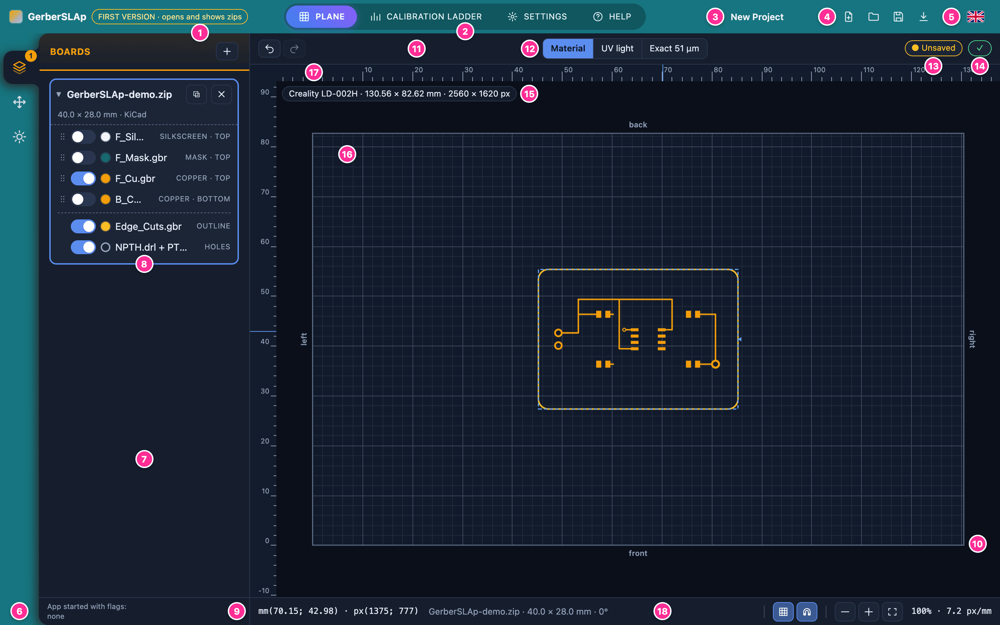
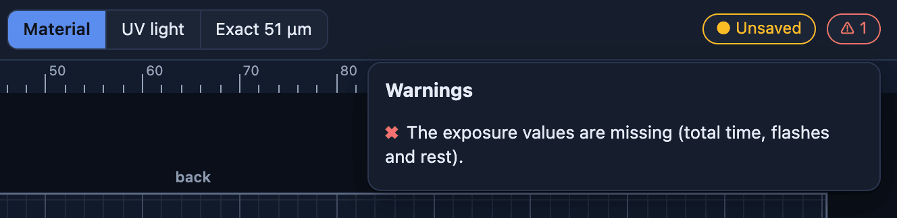
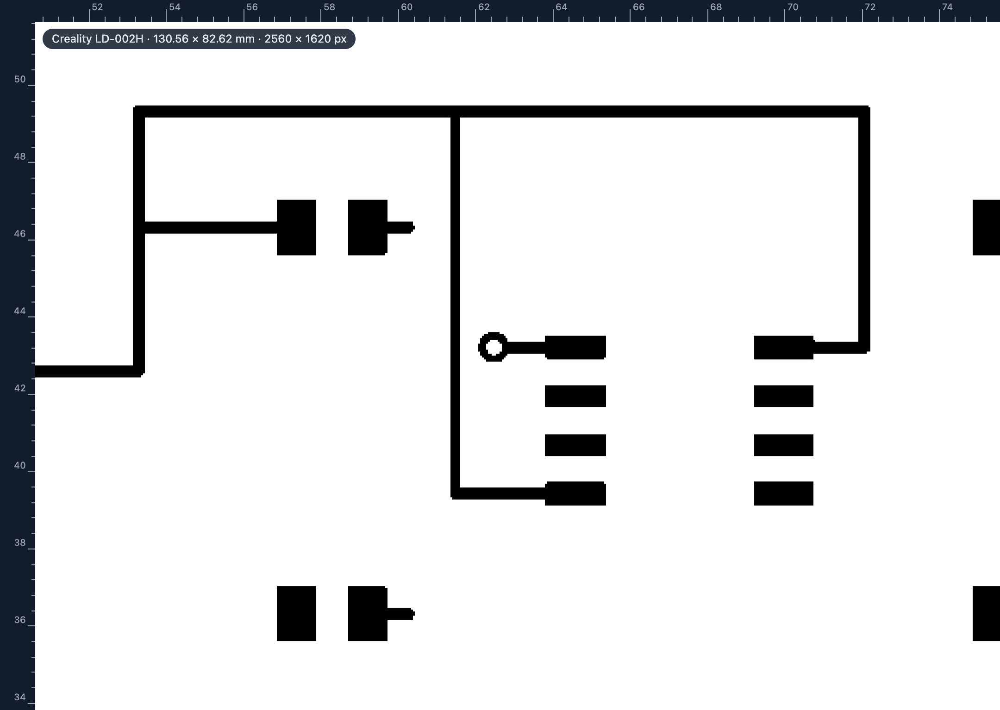
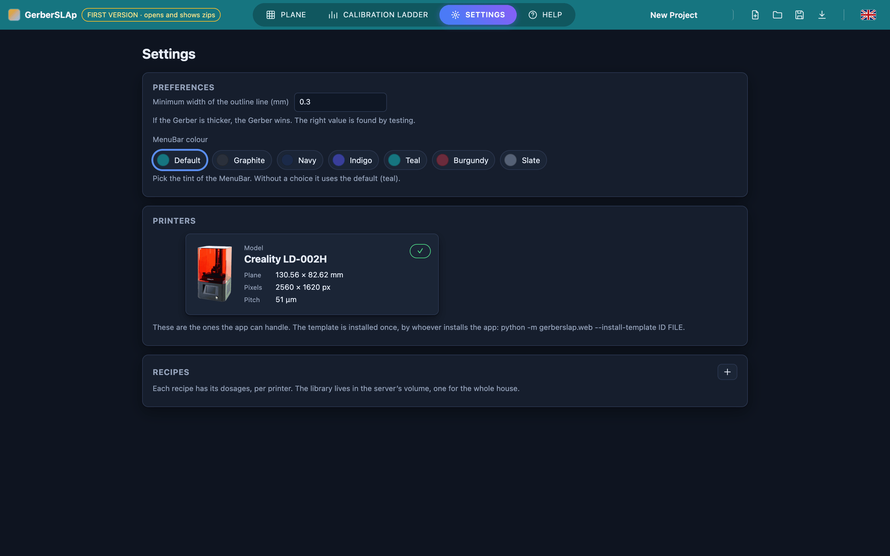
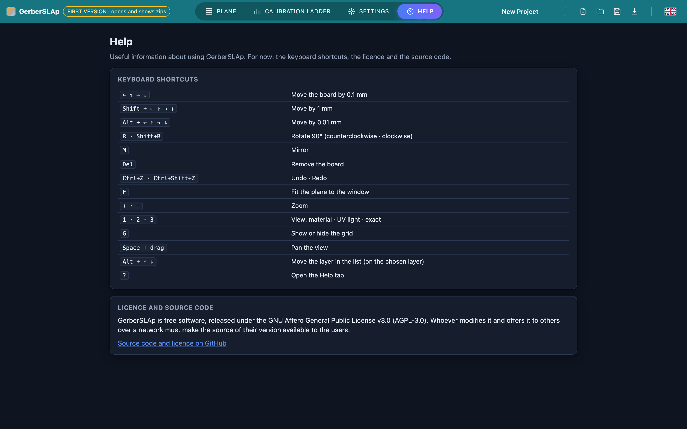

# Interface tour

This chapter gives a name to every part of the page. **The names are the ones used throughout the manual**: when a chapter says “the StatusPill” or “the BoardCard”, it means the zone you see numbered here. The images enlarge with a click.

## At a glance

The page presents itself in two ways. In the **Plane** section, below, the SideBar and the SidePanel are on the left and the CadWindow, where you draw, on the right. The other sections of the TabMenu (Calibration ladder, Settings, Help) take up the whole page under the MenuBar (see [Outside the Plane](#outside-the-plane)).

[{ loading=lazy }](img/interface-1-overview.png){ target=_blank }

| No. | Zone | What it is |
|---|---|---|
| 1 | MenuBar | The bar at the top: the app's name with the yellow version pill, the sections, the project name and the file buttons. |
| 2 | TabMenu | The sections of the app: Plane, Calibration ladder, Settings, Help. |
| 3 | ProjectName | The name of the project, “New Project” until it has one. |
| 4 | FileMenu | The New, Open, Save and Download buttons. |
| 5 | LanguageSelector | The flag: Italian or English. |
| 6 | SideBar | The column of icons on the left: Boards, Placement, Exposure. |
| 7 | SidePanel | The part next to the SideBar, with the chosen section. It can be widened and narrowed. |
| 8 | BoardCard | The card of one board, with its name and its layers. |
| 9 | SideStatusBar | The bar at the bottom of the SidePanel: it says which options the app was started with. |
| 10 | CadWindow | The area where you draw: the plane with its rulers. |
| 11 | CadTitleBar | The header of the CadWindow: Undo and Redo, the views and the two pills. |
| 12 | TabViews | The three views of the plane: Material, UV light, Exact. |
| 13 | SavingPill | The saving pill: “Unsaved”, or “Saved” with the time. |
| 14 | StatusPill | The warnings pill: a green tick, or a warning sign with a number. |
| 15 | PrinterPill | The pill of the printer in use, at the top left of the CadWindow. |
| 16 | LCDPlane | The plane: the LCD screen seen from above. |
| 17 | Rulers | The rulers in millimetres, at the top and on the left. |
| 18 | StatusBar | The bar under the plane: cursor, selected board, grid, snap and zoom. |

!!! tip "The buttons only have an icon"
    Buttons that do something show only an icon: the name appears when you hold the pointer over it, and screen readers read it too. The three views, the sections of the TabMenu and the buttons of the confirmation windows keep their text.

## The MenuBar

[{ loading=lazy }](img/interface-2-menubar.png){ target=_blank }

From left to right:

- the name **GerberSLAp** and the yellow pill, which only gives the version;
- the **TabMenu**, with the open section highlighted;
- the **ProjectName**, the name of the project. Change it with a double click (or with ++enter++ or ++f2++ when it has the focus): ++enter++ or a click outside confirms, ++esc++ cancels. It is also the name of the file that “Download” produces, with spaces and accents replaced by “\_”, and it is part of the project: changing it marks the project as “Unsaved”;
- the **FileMenu**: New project, Open a project from a file, Save and Download. “Save” keeps a working copy in the browser; “Download” produces the project file (`.gslp`). Save and Download stay off while there is no board on the plane. The [Projects](projects.md) chapter explains how to use them;
- the **LanguageSelector**: the flag opens the choice between Italian and English, which the browser remembers.

## The SideBar and the SidePanel

The **SideBar** has three icons, one for each section of the **SidePanel**:

| Icon | Section | What it is for |
|---|---|---|
| The three stacked layers | Boards | Adding boards and choosing which layers they expose. Chapter [Boards](boards.md). |
| The four arrows | Placement | Saying where the board sits on the plane: coordinates, rotation and mirror. Chapter [Placement](placement.md). |
| The sun | Exposure | Choosing polarity and exposure values and generating the file. Chapter [Exposure](exposure.md). |

A number on the Boards icon says how many boards are on the plane. A dot appears on the Placement icon when the selected board goes outside the plane.

The SidePanel is widened and narrowed by dragging its right edge, or with the arrow keys when the edge has the focus. A double click restores the starting width. At the bottom is the **SideStatusBar**, always present whatever the section: it writes “App started with flags:” and the names of the options the app was started with, or “none” (for the options see [Configuration](../installation/configuration.md)). It never shows folders, addresses or ports.

In the Boards section each board has its **BoardCard**, with the file name, the size, the CAD program recognised and the list of layers, each with its switch (see the [Boards](boards.md) chapter).

## The CadWindow

The CadWindow is the area on the right. At the top is the **CadTitleBar**, below it the plane with its rulers, and at the bottom the **StatusBar**.

### The CadTitleBar

From left to right:

- **Undo** and **Redo**;
- the three views, the **TabViews**: Material, UV light and Exact (see [The three views](#the-three-views));
- the **SavingPill** says when the last save was (“Saved 14:32”) and adds “Unsaved” if there are changes. It is not a button: saving is done from the FileMenu;
- the **StatusPill** is a green tick when all is well; otherwise it shows a warning sign and the number of warnings. A click opens the list.

[{ loading=lazy }](img/interface-3-warning.png){ target=_blank }

Here the warning is “The exposure values are missing (total time, flashes and rest)”. Each warning says what is wrong; the list of the ones the app can give, with the remedy, is in [Warnings and problems](troubleshooting.md#warnings).

### The plane

The **LCDPlane** is the printer's LCD screen seen from above: what you draw here is what the printer projects. The **PrinterPill**, at the top left, says which printer is in use with the size of its plane in millimetres and in pixels (for the LD-002H, 130.56 × 82.62 mm and 2560 × 1620 px): the page knows no printer by itself, every measure comes from the chosen one.

On the four sides are written **front**, **back**, **left** and **right**, as seen by someone standing in front of the printer: the front is the side towards you. The **Rulers** are in millimetres and start from the bottom-left corner of the plane.

### The StatusBar

[{ loading=lazy }](img/interface-4-statusbar.png){ target=_blank }

From left to right:

- the **cursor position**, written `mm(x; y) · px(x; y)`: the millimetres start from the bottom-left corner of the plane, the pixels are those of the plane seen from above, counted from the top left (column; row);
- the **selected board**: name, size and angle, with “mirrored” at the end if it is;
- **Grid** and **Snap**, two toggle buttons (pressed = on). Grid shows or hides the lines of the plane (also with the ++g++ key). With Snap on, a dragged board snaps to the edges and the centre of the plane and to the edges and the centre of the other boards, and dashed guide lines appear;
- the **zoom**: zoom out, zoom in and fit the plane to the window, then the value, for example `100% · 7.2 px/mm`. 100% is the plane fitted to the window, and next to it is how many screen pixels make a millimetre.

## Moving on the plane

| Gesture | What it does |
|---|---|
| Click on a board | Selects it. |
| Drag a board | Moves it. |
| Double click on a board | Opens the Placement section. |
| Mouse wheel | Zooms around the pointer. |
| Drag with the middle or right button | Moves the view. |
| ++space++ and drag | Moves the view (the plane must have the focus: one click on it is enough). |

To place a board precisely, use the arrow keys of the keyboard (see [Keyboard shortcuts](#keyboard-shortcuts)) or the numbers of the Placement section.

## The three views

The **TabViews** change the way the plane shows the boards. They never change what is exposed: only how you look at it.

| View | What it shows |
|---|---|
| Material | The layers of the board with their colours, in the order they are stacked. It is the working view. |
| UV light | What the screen will project, drawn as vectors: white for light, black for what stays dark. It depends on the resist polarity chosen in the Exposure section. |
| Exact | The mask computed by the server, pixel by pixel, at the printer's pixel size (in the name of the view, for example “Exact 51 µm”). As in UV light, white is light. |

The Exact view is recomputed after every change and appears with a short delay. Zoomed in enough, it shows the stair-stepping of the edges, which is what the printer actually receives:

[{ loading=lazy }](img/interface-5-exact.png){ target=_blank }

## Outside the Plane

When a section other than the Plane is opened, the SidePanel, the SideStatusBar and the CadWindow disappear and the page takes up all the space under the MenuBar. The **Calibration ladder** has its own [chapter](calibration-ladder.md). The other two are:

**Settings** gathers what does not belong to a project: the **Preferences** (the minimum width of the outline line and the colour of the MenuBar), the **Printers** the app can handle, each with a green tick when it is ready, and the **Recipes** with their dosages. The [Settings](settings.md) chapter explains them one by one.

[{ loading=lazy }](img/interface-6-settings.png){ target=_blank }

**Help** has the list of keyboard shortcuts, the app's licence and the link to the source code.

[{ loading=lazy }](img/interface-7-help.png){ target=_blank }

## Keyboard shortcuts

They work in the Plane section and only when you are not typing in a field. On a Mac, ++cmd++ counts as ++ctrl++.

### On the selected board

You select a board with a click on the plane or in the list.

| Keys | What it does |
|---|---|
| ++"←"++ ++"↑"++ ++"→"++ ++"↓"++ | Moves the board by 0.1 mm. |
| ++shift+"←"++ ++shift+"↑"++ ++shift+"→"++ ++shift+"↓"++ | Moves by 1 mm. |
| ++alt+"←"++ ++alt+"↑"++ ++alt+"→"++ ++alt+"↓"++ | Moves by 0.01 mm. |
| ++r++ | Rotates by 90° counter-clockwise. |
| ++shift+r++ | Rotates by 90° clockwise. |
| ++m++ | Mirrors the board. |
| ++del++ or ++backspace++ | Removes the board. |

### On the plane

| Keys | What it does |
|---|---|
| ++ctrl+z++ | Undo. |
| ++ctrl+shift+z++ or ++ctrl+y++ | Redo. |
| ++f++ or ++0++ | Fits the plane to the window. |
| ++plus++ and ++minus++ | Zooms in and out. |
| ++1++ ++2++ ++3++ | Material, UV light, Exact view. |
| ++g++ | Shows or hides the grid. |
| ++space++ and drag | Moves the view. |

### Other shortcuts

| Keys | What it does |
|---|---|
| ++alt+"↑"++ ++alt+"↓"++ | In the list of layers, moves the layer up or down, with the focus on its row. Also ++"↑"++ and ++"↓"++ with the focus on the handle. |
| ++question++ | From any section, opens the Help section. |
