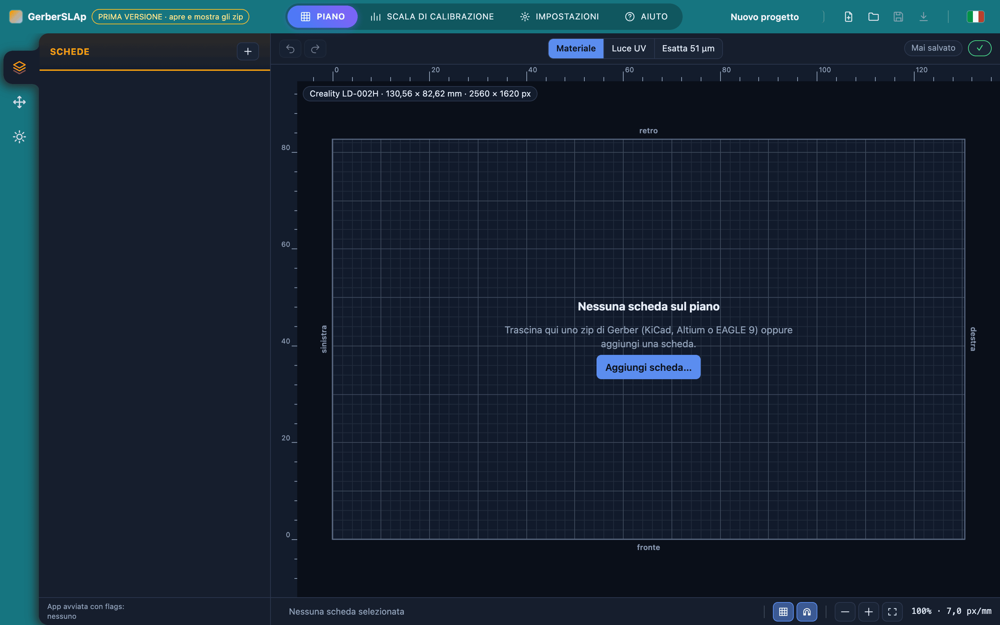
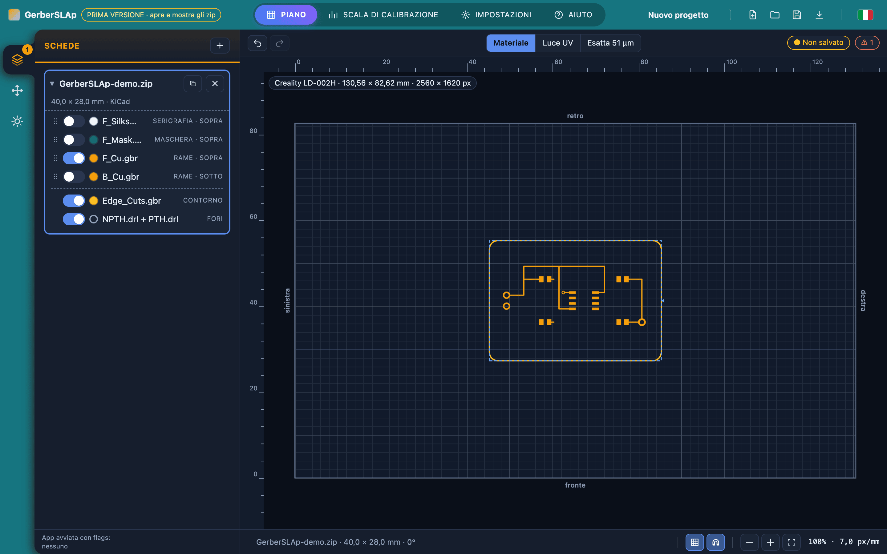
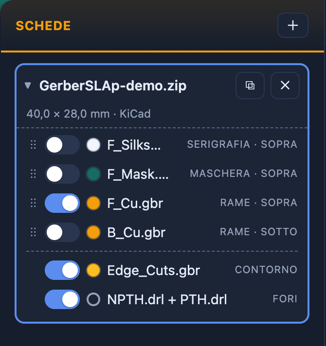
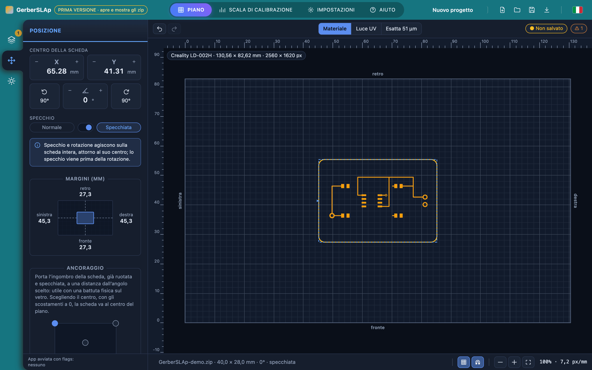
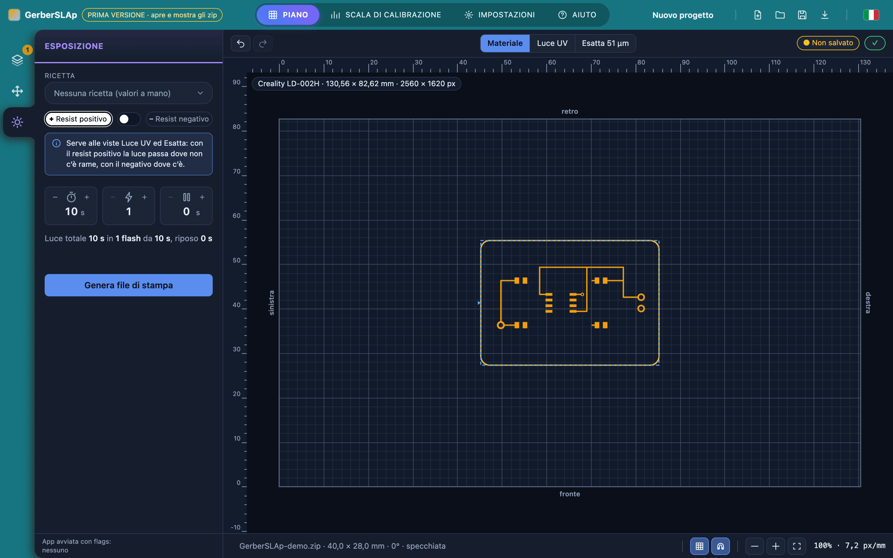
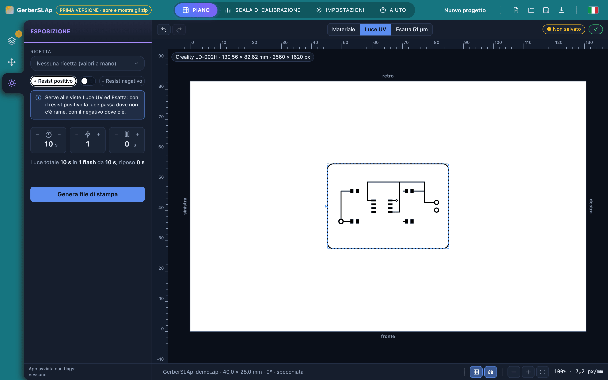
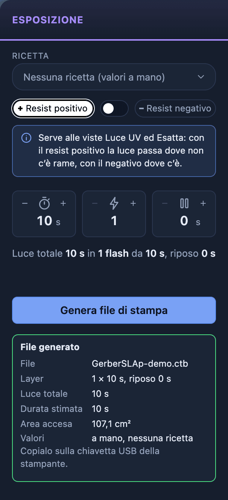

# Primi passi

Questo capitolo accompagna la preparazione del primo file di stampa, dallo zip dei Gerber all'esposizione. Si usa una **scheda di esempio**, che si scarica dal sito, così ogni passo si può rifare con lo stesso risultato. I capitoli seguenti spiegano nel dettaglio ogni fase. Le immagini si ingrandiscono con un clic.

!!! info "Prima di cominciare"
    L'app deve essere avviata e la stampante deve risultare **Pronta**, cioè con il template installato: vedi [Installare l'app](../installation/install.md) e [Requisiti e template](../installation/requirements.md#il-template-della-stampante). Senza template tutto funziona fino alla generazione, ma il file non si può produrre.

## La scheda di esempio

[Scarica GerberSLAp-demo.zip](../../assets/GerberSLAp-demo.zip){ .md-button }

È una scheda inventata di 40 × 28 mm: un piccolo lampeggiatore a LED con un circuito integrato SOIC-8, tre componenti 0805, un connettore a due pin e un punto di prova. Lo zip ha i file che esporta un programma CAD: rame sopra e sotto, contorno, maschera di saldatura, serigrafia e fori.

!!! warning "Serve solo a imparare il programma"
    Il disegno è inventato per questo manuale: non è un progetto verificato e non è mai stato inciso.

## 1. Aggiungere la scheda

Si apre l'app nel browser (di solito `http://127.0.0.1:8800`). Al centro c'è il **piano**, cioè lo schermo LCD visto dall'alto con i righelli in millimetri, e in alto a sinistra la **PrinterPill** dice quale stampante è in uso: qui la Creality LD-002H, 130,56 × 82,62 mm.

[{ loading=lazy }](img/first-steps-1-empty.png){ target=_blank }

Si trascina lo zip sulla pagina, oppure si preme «Aggiungi scheda…». La scheda compare sul piano e nella sezione **Schede**.

[{ loading=lazy }](img/first-steps-2-board.png){ target=_blank }

## 2. Che cosa si vede

La **BoardCard** della sezione Schede dice il nome del file, la misura (40,0 × 28,0 mm) e il programma CAD che l'app ha riconosciuto da sola: qui KiCad, perché i nomi dei file seguono quelli che KiCad scrive. Sotto ci sono i **layer** dello zip, ognuno con il suo ruolo (serigrafia, maschera, rame sopra, rame sotto, contorno, fori).

{ width="335" loading=lazy }

Ogni layer ha un interruttore: **il file di stampa espone i layer accesi**. All'apertura sono accesi il rame sopra, il contorno e i fori, e sul piano si vede proprio questo. Per l'esempio si lasciano così; con una basetta vera si accende il layer di rame da esporre.

## 3. Posizionarla

La sezione **Posizione** (la seconda icona della **SideBar**) dice dove sta la scheda sul piano: le coordinate del suo centro, la rotazione e lo specchio. I margini mostrano la distanza dai quattro bordi del piano.

Se la basetta si appoggia con il rame verso lo schermo, l'immagine va **specchiata** da sinistra a destra. Per l'esempio si attiva «Specchiata»: sul piano il disegno si capovolge subito, e la barra in basso lo riporta con «specchiata».

[{ loading=lazy }](img/first-steps-4-placement.png){ target=_blank }

## 4. Scegliere resist ed esposizione

La sezione **Esposizione** (la terza icona) ha tre cose:

- la **ricetta**, che qui è «Nessuna ricetta (valori a mano)»;
- la **polarità** del resist, positivo o negativo: con il positivo la luce passa dove **non** c'è rame, con il negativo dove c'è;
- i tre valori dell'esposizione: **tempo totale** in secondi, numero di **flash** e **riposo** tra un flash e l'altro.

Finché i valori mancano, la **StatusPill** in alto a destra segnala un avviso, «Mancano i valori di esposizione (tempo totale, flash e riposo)», e il pulsante per generare il file resta spento. Per l'esempio si lascia il resist positivo e si scrive 10 s, 1 flash, 0 s di riposo.

[{ loading=lazy }](img/first-steps-5-exposure.png){ target=_blank }

!!! warning "Sono valori d'esempio, non una ricetta"
    Il tempo giusto dipende dal resist e dalla stampante. La prima volta con un resist nuovo si cerca con la [Scala di calibrazione](calibration-ladder.md), e il risultato si salva come dosaggio in una ricetta. Il file della scala è generato dall'app ma **non è ancora stato provato sulla stampante**.

La vista **Luce UV** mostra che cosa proietterà lo schermo: in bianco la luce, in nero ciò che resta al buio. Con il resist positivo la luce passa ovunque tranne dove c'è rame, e il disegno è specchiato come si è scelto.

[{ loading=lazy }](img/first-steps-6-uv.png){ target=_blank }

## 5. Generare il file

Si preme «Genera file di stampa». L'app controlla tutto, disegna la maschera al pixel, scrive il file e lo rilegge per confrontarlo con quello voluto prima di consegnarlo. Il browser lo scarica come un file qualunque, e sotto il pulsante compare il riquadro **File generato** con il riepilogo.

{ width="303" loading=lazy }

Qui il file ha un solo layer da 10 s, la luce dura 10 s in tutto, e l'area accesa è quasi tutto il piano, perché con il resist positivo il rame occupa poco. Se qualcosa non va, il pulsante resta spento e il motivo è scritto sotto: gli avvisi sono elencati in [Avvisi e problemi](troubleshooting.md).

## E poi

1. **Si copia il file `.ctb` sulla chiavetta USB** e si avvia la stampa dalla stampante: [Dal file alla stampante](printing.md). La stampante non ha rete.
2. **Si sviluppa e si incide la basetta**, fuori da GerberSLAp.

Per usare una scheda tua invece di quella d'esempio i passi sono gli stessi, e i capitoli seguenti li approfondiscono: il [Tour dell'interfaccia](interface.md), le [Schede](boards.md), la [Posizione](placement.md), l'[Esposizione](exposure.md) e i [Progetti](projects.md), per salvare il lavoro e riprenderlo.
