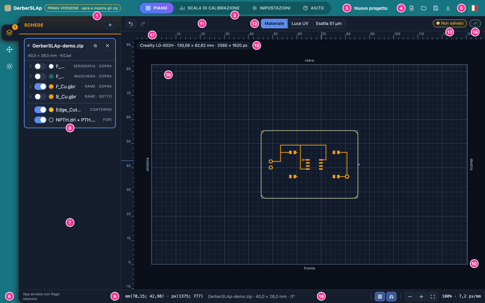
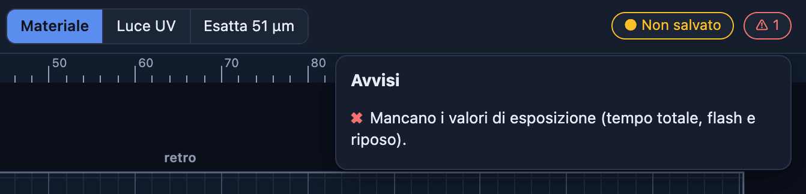
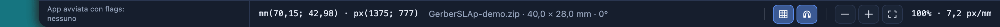
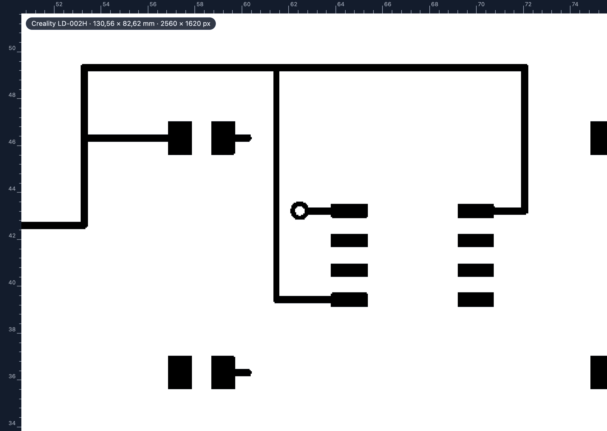
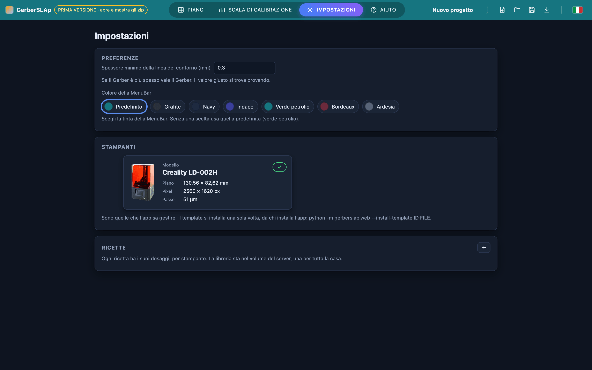
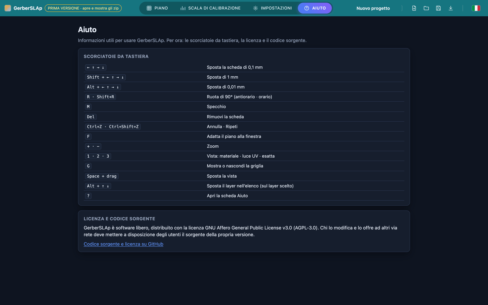

# Tour dell'interfaccia

Questo capitolo dà un nome a ogni parte della pagina. **I nomi sono quelli usati in tutto il manuale**: quando un capitolo dice «la StatusPill» o «la BoardCard», si intende la zona che qui si vede numerata. Le immagini si ingrandiscono con un clic.

## Colpo d'occhio

La pagina ha due modi di presentarsi. Nella sezione **Piano**, qui sotto, a sinistra stanno la SideBar e il SidePanel e a destra la CadWindow, dove si disegna. Le altre sezioni del TabMenu (Scala di calibrazione, Impostazioni, Aiuto) occupano invece tutta la pagina sotto la MenuBar (vedi [Fuori dal Piano](#fuori-dal-piano)).

[{ loading=lazy }](img/interface-1-overview.png){ target=_blank }

| N. | Zona | Che cos'è |
|---|---|---|
| 1 | MenuBar | La barra in alto: il nome dell'app con la pillola gialla della versione, le sezioni, il nome del progetto e i pulsanti dei file. |
| 2 | TabMenu | Le sezioni dell'app: Piano, Scala di calibrazione, Impostazioni, Aiuto. |
| 3 | ProjectName | Il nome del progetto, «Nuovo progetto» finché non ne ha uno. |
| 4 | FileMenu | I pulsanti Nuovo, Apri, Salva e Scarica. |
| 5 | LanguageSelector | La bandierina: italiano o inglese. |
| 6 | SideBar | La colonna di icone a sinistra: Schede, Posizione, Esposizione. |
| 7 | SidePanel | La parte accanto alla SideBar, con la sezione scelta. Si può allargare e stringere. |
| 8 | BoardCard | La card di una scheda, con il suo nome e i suoi layer. |
| 9 | SideStatusBar | La barra in fondo al SidePanel: dice con quali opzioni è stata avviata l'app. |
| 10 | CadWindow | La zona in cui si disegna: il piano con i righelli. |
| 11 | CadTitleBar | L'intestazione della CadWindow: Annulla e Ripeti, le viste e le due pillole. |
| 12 | TabViews | Le tre viste del piano: Materiale, Luce UV, Esatta. |
| 13 | SavingPill | La pillola del salvataggio: «Non salvato», oppure «Salvato» con l'ora. |
| 14 | StatusPill | La pillola degli avvisi: una spunta verde, oppure un segno di avviso con il numero. |
| 15 | PrinterPill | La pillola della stampante in uso, in alto a sinistra nella CadWindow. |
| 16 | LCDPlane | Il piano: lo schermo LCD visto dall'alto. |
| 17 | Rulers | I righelli in millimetri, in alto e a sinistra. |
| 18 | StatusBar | La barra sotto il piano: cursore, scheda selezionata, griglia, scatto e zoom. |

!!! tip "I pulsanti hanno solo l'icona"
    I pulsanti che compiono un'azione mostrano solo un'icona: il nome compare fermando il puntatore sopra, ed è letto anche dai programmi per la lettura dello schermo. Restano con il testo le tre viste, le sezioni del TabMenu e i pulsanti delle finestre di conferma.

## La MenuBar

[{ loading=lazy }](img/interface-2-menubar.png){ target=_blank }

Da sinistra a destra:

- il nome **GerberSLAp** e la pillola gialla, che dice solo la versione;
- il **TabMenu**, con la sezione aperta in evidenza;
- il **ProjectName**, il nome del progetto. Si cambia con un doppio clic (oppure con ++enter++ o ++f2++ quando ha il fuoco): ++enter++ o un clic fuori lo conferma, ++esc++ annulla. È anche il nome del file che «Scarica» produce, con spazi e accenti sostituiti da «\_», e fa parte del progetto: cambiarlo lo segna come «Non salvato»;
- il **FileMenu**: Nuovo progetto, Apri un progetto da file, Salva e Scarica. «Salva» tiene una copia di lavoro nel browser; «Scarica» produce il file del progetto (`.gslp`). Salva e Scarica restano spenti finché sul piano non c'è nessuna scheda. Il capitolo [Progetti](projects.md) spiega come si usano;
- il **LanguageSelector**: la bandierina apre la scelta tra italiano e inglese, che il browser ricorda.

## La SideBar e il SidePanel

La **SideBar** ha tre icone, una per sezione del **SidePanel**:

| Icona | Sezione | A che cosa serve |
|---|---|---|
| I tre piani sovrapposti | Schede | Aggiungere le schede e scegliere quali layer espongono. Capitolo [Schede](boards.md). |
| Le quattro frecce | Posizione | Dire dove sta la scheda sul piano: coordinate, rotazione e specchio. Capitolo [Posizione](placement.md). |
| Il sole | Esposizione | Scegliere polarità e valori di esposizione e generare il file. Capitolo [Esposizione](exposure.md). |

Sull'icona delle Schede un numero dice quante schede ci sono sul piano. Sull'icona di Posizione compare un pallino quando la scheda selezionata esce dal piano.

Il SidePanel si allarga e si stringe trascinando il suo bordo destro, oppure con le frecce quando il bordo ha il fuoco. Un doppio clic ripristina la larghezza di partenza. In fondo c'è la **SideStatusBar**, sempre presente quale che sia la sezione: scrive «App avviata con flags:» e i nomi delle opzioni con cui è partita l'app, oppure «nessuno» (per le opzioni vedi [Configurazione](../installation/configuration.md)). Non mostra mai cartelle, indirizzi o porte.

Nella sezione Schede ogni scheda ha la sua **BoardCard**, con il nome del file, la misura, il programma CAD riconosciuto e l'elenco dei layer, ognuno con il suo interruttore (vedi il capitolo [Schede](boards.md)).

## La CadWindow

La CadWindow è la zona a destra. In alto ha la **CadTitleBar**, sotto il piano con i righelli e in fondo la **StatusBar**.

### La CadTitleBar

Da sinistra a destra:

- **Annulla** e **Ripeti**;
- le tre viste, le **TabViews**: Materiale, Luce UV ed Esatta (vedi [Le tre viste](#le-tre-viste));
- la **SavingPill** dice quando c'è stato l'ultimo salvataggio («Salvato 14:32») e aggiunge «Non salvato» se ci sono modifiche. Non è un pulsante: il salvataggio si fa dal FileMenu;
- la **StatusPill** è una spunta verde quando va tutto bene; altrimenti mostra un segno di avviso e il numero degli avvisi. Un clic apre l'elenco.

[{ loading=lazy }](img/interface-3-warning.png){ target=_blank }

In questo caso l'avviso è «Mancano i valori di esposizione (tempo totale, flash e riposo)». Ogni avviso dice che cosa non va; l'elenco di quelli che l'app può dare, con il rimedio, è in [Avvisi e problemi](troubleshooting.md#avvisi).

### Il piano

Il **LCDPlane** è lo schermo LCD della stampante visto dall'alto: ciò che si disegna qui è ciò che la stampante proietta. La **PrinterPill**, in alto a sinistra, dice quale stampante è in uso con le dimensioni del suo piano in millimetri e in pixel (per la LD-002H, 130,56 × 82,62 mm e 2560 × 1620 px): la pagina non conosce nessuna stampante, ogni misura viene da quella scelta.

Ai quattro lati sono scritti **fronte**, **retro**, **sinistra** e **destra**, come li vede chi sta davanti alla stampante: il fronte è il lato verso di sé. I **Rulers** sono in millimetri e partono dall'angolo in basso a sinistra del piano.

### La StatusBar

[{ loading=lazy }](img/interface-4-statusbar.png){ target=_blank }

Da sinistra a destra:

- la **posizione del cursore**, scritta `mm(x; y) · px(x; y)`: i millimetri partono dall'angolo in basso a sinistra del piano, i pixel sono quelli del piano visto dall'alto, contati da in alto a sinistra (colonna; riga);
- la **scheda selezionata**: nome, dimensioni e angolo, con «specchiata» in fondo se lo è;
- **Griglia** e **Scatto**, due pulsanti a levetta (premuti = accesi). La Griglia mostra o nasconde le linee del piano (anche con il tasto ++g++). Con lo Scatto acceso, una scheda trascinata si aggancia ai bordi e al centro del piano e ai bordi e al centro delle altre schede, e compaiono le linee guida tratteggiate;
- lo **zoom**: riduci, ingrandisci e adatta il piano alla finestra, poi il valore, per esempio `100% · 7,2 px/mm`. Il 100% è il piano adattato alla finestra, e accanto sta quanti pixel dello schermo fanno un millimetro.

## Muoversi sul piano

| Gesto | Che cosa fa |
|---|---|
| Clic su una scheda | La seleziona. |
| Trascinare una scheda | La sposta. |
| Doppio clic su una scheda | Apre la sezione Posizione. |
| Rotella del mouse | Zoom attorno al puntatore. |
| Trascinare con il tasto centrale o destro | Sposta la vista. |
| ++space++ e trascinare | Sposta la vista (il piano deve avere il fuoco: basta un clic su di esso). |

Per posizionare una scheda con precisione si usano le frecce della tastiera (vedi [Scorciatoie da tastiera](#scorciatoie-da-tastiera)) o i numeri della sezione Posizione.

## Le tre viste

Le **TabViews** cambiano il modo in cui il piano mostra le schede. Non cambiano mai cosa si espone: cambia solo come lo si guarda.

| Vista | Che cosa mostra |
|---|---|
| Materiale | I layer della scheda con i loro colori, nell'ordine in cui sono impilati. È la vista di lavoro. |
| Luce UV | Ciò che proietterà lo schermo, disegnato in vettoriale: in bianco la luce, in nero ciò che resta al buio. Dipende dalla polarità del resist scelta nella sezione Esposizione. |
| Esatta | La maschera calcolata dal server, pixel per pixel, alla misura dei pixel della stampante (nel nome della vista, per esempio «Esatta 51 µm»). Come in Luce UV, il bianco è la luce. |

La vista Esatta si ricalcola dopo ogni modifica e compare con un breve ritardo. Ingrandita abbastanza, mostra la scalinatura dei bordi, che è ciò che la stampante riceve davvero:

[{ loading=lazy }](img/interface-5-exact.png){ target=_blank }

## Fuori dal Piano

Quando si apre una sezione diversa dal Piano, il SidePanel, la SideStatusBar e la CadWindow scompaiono e la pagina occupa tutto lo spazio sotto la MenuBar. La **Scala di calibrazione** ha il suo [capitolo](calibration-ladder.md). Le altre due sono:

**Impostazioni** raccoglie ciò che non riguarda un progetto: le **Preferenze** (lo spessore minimo della linea del contorno e il colore della MenuBar), le **Stampanti** che l'app sa gestire, ciascuna con la spunta verde quando è pronta, e le **Ricette** con i loro dosaggi. Il capitolo [Impostazioni](settings.md) le spiega una per una.

[{ loading=lazy }](img/interface-6-settings.png){ target=_blank }

**Aiuto** ha l'elenco delle scorciatoie da tastiera, la licenza dell'app e il collegamento al codice sorgente.

[{ loading=lazy }](img/interface-7-help.png){ target=_blank }

## Scorciatoie da tastiera

Funzionano nella sezione Piano e solo quando non si sta scrivendo in un campo. Su un Mac, ++cmd++ vale come ++ctrl++.

### Sulla scheda selezionata

Si seleziona con un clic sul piano o nell'elenco.

| Tasti | Che cosa fa |
|---|---|
| ++"←"++ ++"↑"++ ++"→"++ ++"↓"++ | Sposta la scheda di 0,1 mm. |
| ++shift+"←"++ ++shift+"↑"++ ++shift+"→"++ ++shift+"↓"++ | Sposta di 1 mm. |
| ++alt+"←"++ ++alt+"↑"++ ++alt+"→"++ ++alt+"↓"++ | Sposta di 0,01 mm. |
| ++r++ | Ruota di 90° in senso antiorario. |
| ++shift+r++ | Ruota di 90° in senso orario. |
| ++m++ | Specchia la scheda. |
| ++del++ oppure ++backspace++ | Rimuove la scheda. |

### Sul piano

| Tasti | Che cosa fa |
|---|---|
| ++ctrl+z++ | Annulla. |
| ++ctrl+shift+z++ oppure ++ctrl+y++ | Ripeti. |
| ++f++ oppure ++0++ | Adatta il piano alla finestra. |
| ++plus++ e ++minus++ | Ingrandisce e riduce. |
| ++1++ ++2++ ++3++ | Vista Materiale, Luce UV, Esatta. |
| ++g++ | Mostra o nasconde la griglia. |
| ++space++ e trascinare | Sposta la vista. |

### Altre scorciatoie

| Tasti | Che cosa fa |
|---|---|
| ++alt+"↑"++ ++alt+"↓"++ | Nell'elenco dei layer sposta il layer su o giù, con il fuoco sulla sua riga. Anche ++"↑"++ e ++"↓"++ con il fuoco sulla maniglia. |
| ++question++ | Da qualunque sezione apre la sezione Aiuto. |
